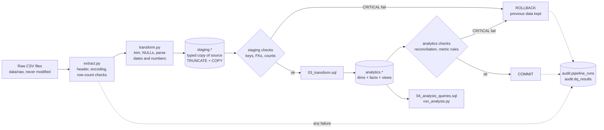

# Architecture

## Data flow



Stages 1-2 (extract, transform) never touch the database, so bad input cannot leave it half-updated.
Everything from staging DDL to the analytics checks is **one transaction**; `COMMIT` happens only if no
CRITICAL check failed. Audit rows are written over a *separate* autocommit connection so that failed runs
are still recorded.

## Loading strategy: documented full refresh

The dataset is small and static, so each run replaces everything (`TRUNCATE` + `COPY`, then rebuild analytics).
* Rerun = same result, no duplicates (proved by `test_second_run_does_not_duplicate_anything` and a content fingerprint of `fact_orders`).
* Failure = rollback to the last good state. Even the DDL is inside the transaction, so a failed *first* run creates nothing.
* An advisory lock refuses a second simultaneous run instead of letting two runs fight over the tables.
* Trade-off: a full refresh does not scale to huge or incremental data; key-based upserts would be the next step.

## Entity-relationship diagram (analytics layer)

```mermaid
erDiagram
    dim_customers ||--o{ fact_orders : places
    fact_orders ||--o{ fact_order_items : contains
    dim_products ||--o{ fact_order_items : "is sold as"
    dim_sellers ||--o{ fact_order_items : "fulfils"
    dim_customers { text customer_id PK }
    fact_orders { text order_id PK
                  text customer_id FK
                  bool is_delivery_eligible
                  bool is_late }
    fact_order_items { text order_id PK_FK
                       int order_item_id PK
                       text product_id FK
                       text seller_id FK }
    dim_products { text product_id PK }
    dim_sellers { text seller_id PK }
```

## Why this model

| Decision | Reason |
| --- | --- |
| `fact_orders` has **one row per order** | all order-level rates use it, so an order with 5 items is counted once (the handbook's main trap) |
| seller/category metrics go through **views at (order, seller) / (order, category) grain** | an order is counted once per seller/category, never once per item |
| seller ranking uses **single-seller orders only** | one delivery date cannot be blamed on one of several sellers |
| delivery metrics are **NULL, not false,** for ineligible orders | `AVG(is_late)` over the table can never silently mix in non-applicable rows |
| staging has **no keys**; analytics has them | staging must be able to *hold* duplicates so checks can *report* them |
| indexes only on columns the analysis filters/joins/groups on | no speculative indexing |
| no Airflow / Spark / Kafka / Docker / dashboard | out of scope for v1 per the handbook |

## Failure behaviour

| Situation | Result |
| --- | --- |
| input file missing / empty / header-only | `FAILED [extract]`, DB untouched |
| required column missing, ragged CSV row, invalid UTF-8 | `FAILED [extract]`, DB untouched |
| unparseable values above `MAX_BAD_VALUE_PCT` (default 1%) in one column | `FAILED [transform]`, DB untouched |
| unparseable values below the threshold | set to NULL, counted with examples in `audit.pipeline_runs.details`, run continues |
| duplicate keys, null keys, orphans, bad prices, row-count mismatch | `FAILED [quality]`, rollback, previous data kept |
| impossible dates, missing categories (WARN checks) | recorded in `audit.dq_results`, run succeeds, rows flagged not deleted |
| database unreachable | exit code 1, logged (no audit possible) |
| another run in progress | `FAILED [load]` |
| every failure | process exit code 1 + `FAILED` audit row + log in `logs/pipeline.log` |
